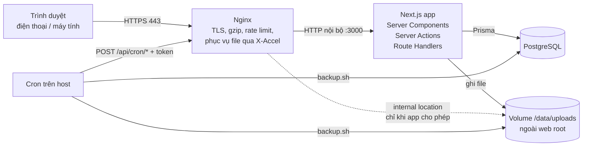

# BƯỚC 2 — KIẾN TRÚC

> Trạng thái: **Bản đề xuất chờ duyệt**

## 1. Tổng quan

**Monolith Next.js (App Router)** chứa cả website công khai, cổng LMS và API. Một container ứng dụng, một container PostgreSQL, một container Nginx.



## 2. Công nghệ chính thức

| Lớp | Lựa chọn | Lý do |
|---|---|---|
| Framework | Next.js (bản ổn định mới nhất lúc khởi tạo, App Router, `output: "standalone"`) | Theo yêu cầu; một dự án cho cả FE + BE |
| Ngôn ngữ | TypeScript `strict` | |
| UI | Tailwind CSS + shadcn/ui (Radix) + lucide-react (icon) | Theo yêu cầu; shadcn sinh code vào repo, không phụ thuộc runtime |
| Form/validate | Zod (+ react-hook-form) | Một schema dùng cả client và server |
| ORM / DB | Prisma + PostgreSQL 16 | Theo yêu cầu; migration có version |
| Auth | Auth.js (next-auth v5), Credentials provider, chiến lược JWT | Credentials của Auth.js chỉ chạy với JWT; bù lại bằng `session_version` để thu hồi phiên |
| Băm mật khẩu | Argon2id (`@node-rs/argon2`) | Chuẩn khuyến nghị OWASP, có binary sẵn, không cần build |
| Rich text | Tiptap (lưu JSON) | Lưu JSON thay vì HTML → render có kiểm soát, chặn XSS từ gốc |
| Biểu đồ | Recharts | Theo yêu cầu |
| Xử lý ảnh | sharp | Nén, tạo kích thước, **xóa EXIF/GPS** (riêng tư trẻ em) |
| Nhận diện file | `file-type` (magic bytes) | Kiểm tra MIME thật, không tin header trình duyệt |
| Ngày giờ | `date-fns` + `@date-fns/tz` | Nhẹ, xử lý múi giờ Asia/Ho_Chi_Minh |
| Kiểm thử | Vitest (unit + integration với Postgres test), Playwright (E2E + responsive) | |
| Hạ tầng | Docker Compose, Nginx, cron của host; giai đoạn đầu chạy trên VM Proxmox tại nhà + Cloudflare Tunnel (`cloudflared`), khi lên VPS dùng Certbot | Miễn phí, đơn giản, không cần mở port ở nhà |

**Không dùng** (cố ý): Redis, hàng đợi (queue), S3, dịch vụ email trả phí, WebSocket. Quy mô hiện tại không cần; tất cả có điểm thay thế rõ ràng khi mở rộng (xem §9).

## 3. Phân lớp mã nguồn

```
Giao diện (app/, components/)          ← chỉ hiển thị, không truy cập DB trực tiếp
   │ gọi
Server Actions / Route Handlers        ← nhận input, validate bằng Zod
   │ gọi
Service theo nghiệp vụ (features/*/service.ts)
   │  1. lấy user hiện tại (getCurrentUser)
   │  2. kiểm tra quyền (server/authz)   ← BẮT BUỘC, không bỏ qua
   │  3. thực thi nghiệp vụ trong transaction
   │  4. ghi activity log / tạo thông báo
   ▼
Prisma (server/db.ts) → PostgreSQL
```

Quy tắc:
- Chỉ file trong `src/server/**` và `src/features/**/service.ts|queries.ts` được import Prisma. Lint rule chặn import Prisma ở nơi khác. Các file này có `import "server-only"`.
- Mọi Server Action bọc qua helper `action()` thống nhất: xác thực → validate Zod → kiểm tra quyền → xử lý lỗi → trả `{ ok, data } | { ok: false, error }`.
- Truy vấn danh sách luôn **lọc theo phạm vi quyền** ngay trong câu Prisma (VD: học viên chỉ thấy bài giảng có `lesson_classes.class_id ∈ lớp đang ACTIVE của mình`), không lấy hết rồi lọc ở client.

## 4. Xác thực & phân quyền (RBAC + kiểm tra theo tài nguyên)

### 4.1 Xác thực
- Đăng nhập bằng **username hoặc email** + mật khẩu.
- JWT trong cookie `HttpOnly; Secure; SameSite=Lax`, thời hạn 7 ngày (học viên) / 12 giờ (admin – cấu hình được).
- JWT chứa `userId`, `role`, `sessionVersion`. Mỗi request phía server đọc lại user từ DB (cache trong phạm vi request) → nếu user bị khóa hoặc `session_version` đổi (đổi mật khẩu, admin "đăng xuất mọi thiết bị") thì phiên bị từ chối ngay.
- Lần đăng nhập đầu: bắt buộc đổi mật khẩu (`must_change_password`).

### 4.2 Chống brute-force & rate limit
- Nginx `limit_req` cho `/api/auth/*`, form công khai, upload.
- Ứng dụng: bảng `rate_limit_buckets` trong Postgres (đủ cho 1 instance, không cần Redis): giới hạn theo IP và theo tài khoản. Sai mật khẩu 5 lần → khóa tài khoản 15 phút, ghi activity log.

### 4.3 Phân quyền
Hai tầng:
1. **Theo vai trò** (`requireRole("TEACHER", "ADMIN")`).
2. **Theo tài nguyên** — các policy thuần (dễ test) trong `src/server/authz/`:

| Policy | Quy tắc |
|---|---|
| `canManageClass(user, classId)` | ADMIN, hoặc TEACHER có trong `class_teachers` của lớp |
| `canViewClass(user, classId)` | trên + STUDENT là thành viên ACTIVE + PARENT có con là thành viên |
| `canViewStudent(user, studentId)` | ADMIN; TEACHER dạy lớp có học viên đó; chính học viên; PARENT có liên kết `parent_students` |
| `canViewLesson(user, lessonId)` | người quản lý lớp; học viên thuộc lớp được gán & bài đã PUBLISHED & đã đến `visible_from` |
| `canAccessFile(user, fileId)` | suy ra từ thực thể sở hữu file (bài giảng / bài nộp / avatar…) |
| `canGrade(user, submissionId)` | ADMIN hoặc GV quản lý lớp của bài tập |
| `canViewAnswers(user, assignmentId)` | GV/Admin; học viên chỉ khi `answer_reveal` cho phép |

Middleware/proxy của Next.js chỉ dùng để **chuyển hướng sớm** (chưa đăng nhập → `/dang-nhap`, sai khu vực vai trò → dashboard của mình). **Không** coi middleware là lớp bảo mật; mọi kiểm tra thật nằm ở service.

Truy cập sai quyền trả **404** (không phải 403) cho tài nguyên theo ID, tránh dò ra ID tồn tại.

## 5. Quản lý file

```
/data/uploads/
  private/<yyyy>/<mm>/<uuid>          ← tài liệu LMS, audio, bài nộp, ghi âm
  public/<yyyy>/<mm>/<uuid>-<size>.webp ← ảnh CMS đã xử lý (banner, gallery, ảnh GV)
```

Luồng upload (`POST /api/uploads`, Route Handler — không dùng Server Action vì giới hạn kích thước body):
1. Xác thực + quyền + rate limit số lần upload.
2. Kiểm tra `Content-Length` ≤ giới hạn theo loại (đọc từ `system_settings`).
3. Ghi stream ra file tạm, đếm byte (cắt nếu vượt giới hạn).
4. Kiểm tra **extension trong danh sách cho phép** + **MIME thật bằng magic bytes** — hai cái phải khớp nhau.
5. Ảnh: sharp xoay đúng chiều, xóa metadata, giới hạn 2560 px, xuất WebP/JPEG.
6. Đổi tên thành UUID ngẫu nhiên, chuyển vào thư mục đích, ghi bản ghi `files` (sha256, kích thước, thời lượng audio).
7. Trả về `fileId` — **không bao giờ trả đường dẫn thật**.

Luồng tải/phát (`GET /api/files/:id`):
1. App kiểm tra `canAccessFile`.
2. Production: trả header `X-Accel-Redirect: /_protected/<storage_key>` → Nginx tự phục vụ file từ `internal` location, **hỗ trợ HTTP Range** (bắt buộc để tua audio/video trên iOS Safari), hiệu năng cao, app không phải giữ stream.
3. Development: app tự stream file có hỗ trợ Range.
4. Header: `Content-Disposition` (inline cho audio/ảnh/PDF, attachment khi `?download=1`), `X-Content-Type-Options: nosniff`, `Cache-Control: private`.

Không thực thi file upload: thư mục upload mount `noexec`, Nginx không có cấu hình chạy script ở đó, Content-Type luôn lấy từ DB.

Giới hạn mặc định (sửa trong Cài đặt hệ thống): ảnh 10 MB · tài liệu 30 MB · audio 30 MB · video 100 MB — **90 MB khi chạy qua Cloudflare Tunnel** (gói Free chặn request > 100 MB, xem DEPLOYMENT.md §0). Nginx `client_max_body_size 110m` cho riêng `/api/uploads`.

## 6. Làm bài & chống mất dữ liệu

- Bắt đầu làm bài → server tạo `submission` trạng thái `IN_PROGRESS`, ghi `started_at` và tính `deadline_at = min(started_at + time_limit, hạn nộp có tính gia hạn)`. **Đồng hồ do server quyết định**, client chỉ hiển thị.
- Tự lưu: mỗi thay đổi lưu ngay vào `localStorage` (khóa theo submissionId); gửi lên server ~1,5 giây sau thay đổi cuối, dùng `PUT /api/submissions/:id/answers` kèm `version` (sai version → 409, tránh ghi đè bản mới bằng bản cũ từ tab khác).
- Mất mạng: hiển thị banner "Đang offline – bài làm vẫn được lưu trên máy", tự đồng bộ lại khi có mạng (`online` event). Khi rời trang dùng `fetch(..., { keepalive: true })`.
- Tải lại trang: lấy bản server, rồi áp các câu còn "chưa lưu" trong `localStorage` lên trên (chỉ các câu chưa gửi được).
- Nộp bài: idempotent (gửi lại không tạo bài nộp thứ hai). Hết giờ: server tự đóng bài với câu trả lời đã lưu gần nhất (kiểm tra lúc request tiếp theo; không cần cron).
- **Đáp án không bao giờ gửi xuống client** khi làm bài. Chấm tự động chạy ở server.

## 7. Tác vụ định kỳ (không cần container riêng)

Cron trên host gọi endpoint nội bộ có token bí mật (`CRON_SECRET`):

| Tác vụ | Tần suất |
|---|---|
| Sinh `class_sessions` 8 tuần tới từ lịch định kỳ | Hằng ngày 01:00 |
| Thông báo "bài tập sắp đến hạn" (trước 24 h) | Mỗi giờ |
| Phát hành bài tập/bài giảng đã hẹn giờ + đóng bài làm hết giờ | 5 phút/lần |
| Dọn file tạm, file mồ côi > 7 ngày | Hằng ngày |
| Backup DB + file | Hằng ngày 02:30 (`scripts/backup.sh`) |

Ngoài ra việc "bài đã đến giờ giao chưa" luôn được tính lúc truy vấn (`available_at <= now()`), nên kể cả cron chậm thì học viên vẫn thấy bài đúng giờ.

## 8. Bảo mật — tóm tắt đối chiếu

| Mối đe dọa | Biện pháp |
|---|---|
| Lưu mật khẩu | Argon2id, không bao giờ log mật khẩu |
| Phiên | Cookie HttpOnly/Secure/SameSite, thu hồi qua `session_version` |
| CSRF | Server Actions kiểm tra Origin (có sẵn trong Next.js); Route Handler POST/PUT kiểm tra `Origin` khớp domain; Auth.js có CSRF token |
| XSS | React escape mặc định; rich text lưu JSON Tiptap, render qua whitelist node; CSP header ở Nginx |
| SQL Injection | Chỉ dùng Prisma query builder; cấm `$queryRawUnsafe` (lint) |
| IDOR / phân quyền | Policy theo tài nguyên ở service, test tự động cho từng trường hợp truy cập trái phép |
| Input | Zod ở mọi điểm vào |
| Upload | §5 |
| Brute-force / DoS | §4.2 |
| Header | HSTS, CSP, X-Frame-Options DENY, Referrer-Policy, Permissions-Policy (chỉ cho micro trên trang làm bài) |
| Bí mật | `.env` không commit; chỉ có `.env.example`; `.gitignore` chặn `.env*` |
| Dữ liệu trẻ em | Không hiển thị công khai; ảnh gallery cần cờ đồng ý; xóa EXIF; nhật ký thao tác dữ liệu học viên; Admin có thể xuất/xóa dữ liệu của một học viên theo yêu cầu phụ huynh |

## 9. Hướng mở rộng khi thành trung tâm

| Khi | Thay đổi |
|---|---|
| Nhiều instance app | Chuyển rate limit sang Redis; file sang S3-compatible (MinIO) — `StorageService` đã có interface sẵn |
| Cần email | Thêm "kênh" email vào `NotificationService` (Nodemailer + SMTP) |
| Zalo OA | Thêm kênh Zalo vào cùng service |
| Nhiều chi nhánh | Thêm bảng `branches` và cột `branch_id` cho classes/users |
| Học phí | Module `tuition` riêng (invoices, payments) |

## 10. Quyết định kiến trúc cần bạn duyệt

1. Auth.js với JWT + kiểm tra `session_version` trong DB (thay vì phiên lưu DB).
2. Lưu rich text dạng JSON Tiptap.
3. Nginx phục vụ file qua `X-Accel-Redirect` (app chỉ cấp quyền).
4. Cron của host thay cho container cron / queue.
5. Rate limit bằng Postgres + Nginx, không Redis.

## 11. Ghi chú triển khai (cập nhật sau Phase 1)

| Chủ đề | Thực tế | Lý do |
|---|---|---|
| Next.js | Bản 16 (Turbopack). `cacheComponents` **tắt** | Gần như mọi trang LMS phụ thuộc người dùng đăng nhập → mô hình render động truyền thống đơn giản, ít rủi ro lộ dữ liệu qua cache |
| Middleware | Next 16 đổi tên thành `src/proxy.ts`; chỉ kiểm tra có cookie phiên để chuyển hướng sớm | Kiểm tra quyền thật nằm ở `getCurrentUser()` / `requireRole()` / `createAction()` |
| Prisma | Prisma 7 + driver adapter `@prisma/adapter-pg`; client sinh vào `src/generated/prisma` (không commit) | Prisma 7 bỏ Rust query engine |
| Múi giờ DB | Kết nối luôn đặt `TimeZone=UTC` | Adapter gửi thời gian không kèm offset; nếu session DB khác UTC sẽ lệch giờ. Đã có test bắt lỗi này |
| Soft delete | Lọc `deletedAt: null` tường minh trong từng truy vấn (không dùng Prisma extension) | Dễ đọc, dễ review; extension của Prisma 7 làm rối kiểu dữ liệu |
| Font | Tự host từ gói `@fontsource` (Be Vietnam Pro, Playfair Display) | Không gọi Google Fonts lúc build/chạy |
| Form | Server Actions + `useActionState`/`useTransition`, validate Zod ở server (bắt buộc) | Không thêm react-hook-form khi chưa cần |
| Ràng buộc SQL riêng | Viết thêm cuối migration `init`; `prisma migrate diff` xác nhận không bị Prisma xoá | Partial unique index, CHECK, index tìm kiếm không dấu |
| Upload | Body thô (`POST /api/uploads?purpose=…&name=…`), không dùng multipart; client dùng XHR để có thanh tiến trình | Stream thẳng xuống đĩa, không giữ cả file trong RAM, không cần thêm thư viện multipart |
| Ảnh trong nội dung bài giảng | Lưu `fileId` trong JSON; cột `lessons.content_file_ids` để kiểm tra quyền xem ảnh | Học viên chỉ xem được ảnh thuộc bài giảng họ được phép xem |
| Giáo viên xem bài giảng | Bài của mình (mọi trạng thái) + mọi bài đã xuất bản của giáo viên khác; chỉ tác giả/Admin sửa | Để giáo viên sao chép, dùng lại bài của nhau |
| Bài nghe | Listening Quiz = bài tập loại `LISTENING` gắn `audio_lessons.assignment_id`; transcript "sau khi nộp bài nghe" bị loại khỏi dữ liệu gửi cho học viên cho tới khi nộp | Không xây hai hệ thống câu hỏi |
| Mô hình câu hỏi (Phase 3) | `src/features/assignments/questions.ts`: hàm thuần (schema soạn câu hỏi, lưu ↔ đọc, bản cho học viên đã bỏ đáp án, chấm tự động) — dùng chung server/client/seed, có unit test từng dạng | Một nơi duy nhất quyết định đáp án đúng & cách tính điểm |
| Câu hỏi bị khóa | Khi đã có bài làm, không sửa/xóa câu hỏi (chỉ đổi thứ tự); dùng *Nhân bản* | Câu trả lời đã lưu tham chiếu id lựa chọn; sửa sẽ làm sai điểm |
| Tự lưu bài làm | Route Handler `PUT /api/submissions/:id/answers` (không phải Server Action) | Để gửi được bằng `fetch(..., { keepalive: true })` khi đóng trang |
| Hết giờ | Không cần cron: bài quá `deadline_at` (+60 giây trễ mạng) được nộp tự động lần kế tiếp có ai chạm tới (mở bài, tự lưu, bắt đầu lại); thời điểm nộp = `deadline_at` | Đơn giản, không thêm tiến trình |
| Ghi âm | Loại file `RECORDING` chỉ qua mục đích upload `recording`; chấp nhận WebM/Ogg (Android, Chrome) và MP4/M4A (iPhone) theo magic bytes | iOS không ghi WebM |
| Bảng điểm | Điểm trung bình quy về thang 10, chỉ tính bài đã chấm; CSV có BOM UTF-8 cho Excel | Bài tập có thể khác thang điểm |
