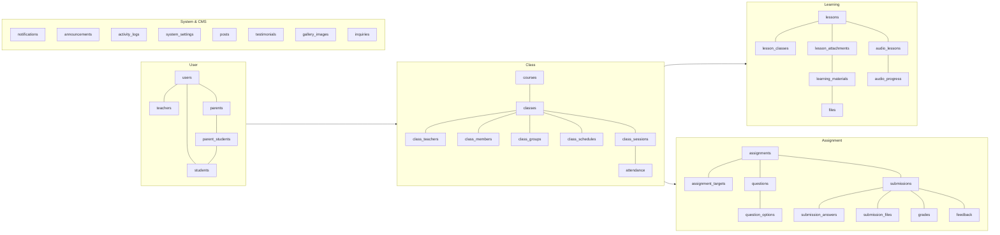
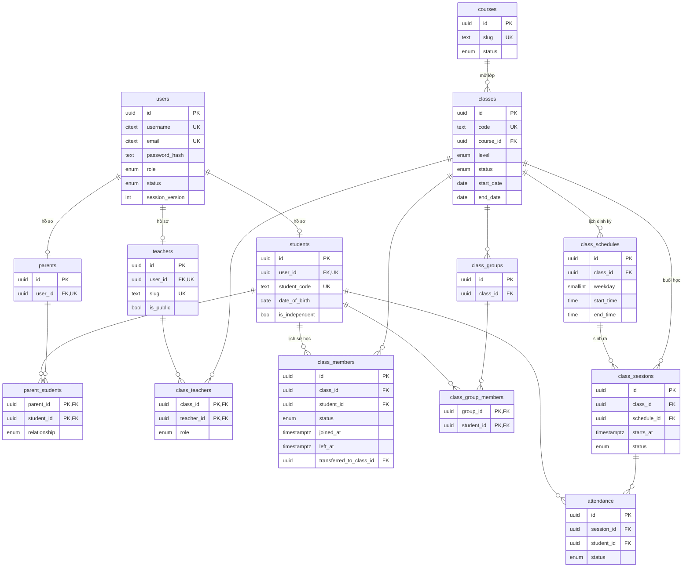
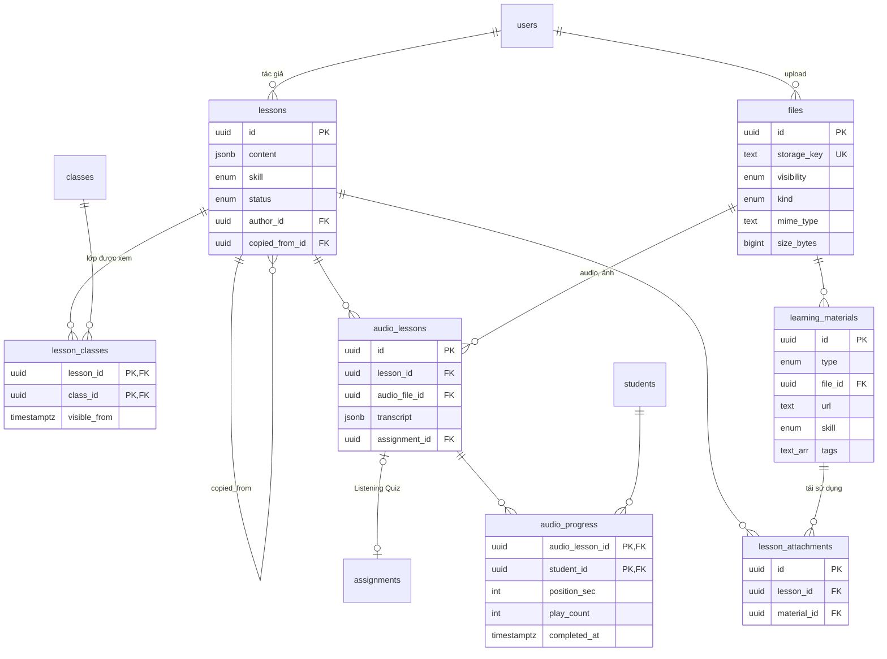
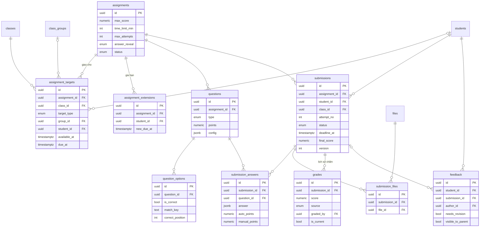
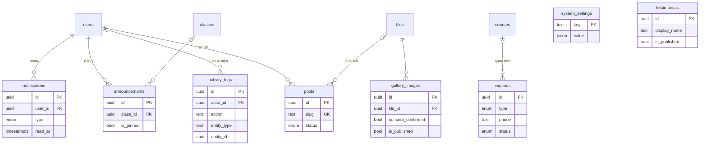

# BƯỚC 3b — ERD

> Sơ đồ viết bằng Mermaid — xem được trực tiếp trên GitHub, GitLab hoặc VS Code (extension "Markdown Preview Mermaid Support").
> Chi tiết cột: [DATABASE.md](DATABASE.md). Sơ đồ chỉ thể hiện khóa và quan hệ chính.

## 1. Tổng quan các nhóm

## 2. User & Class

## 3. Learning

## 4. Assignment & Grading

## 5. System & CMS

